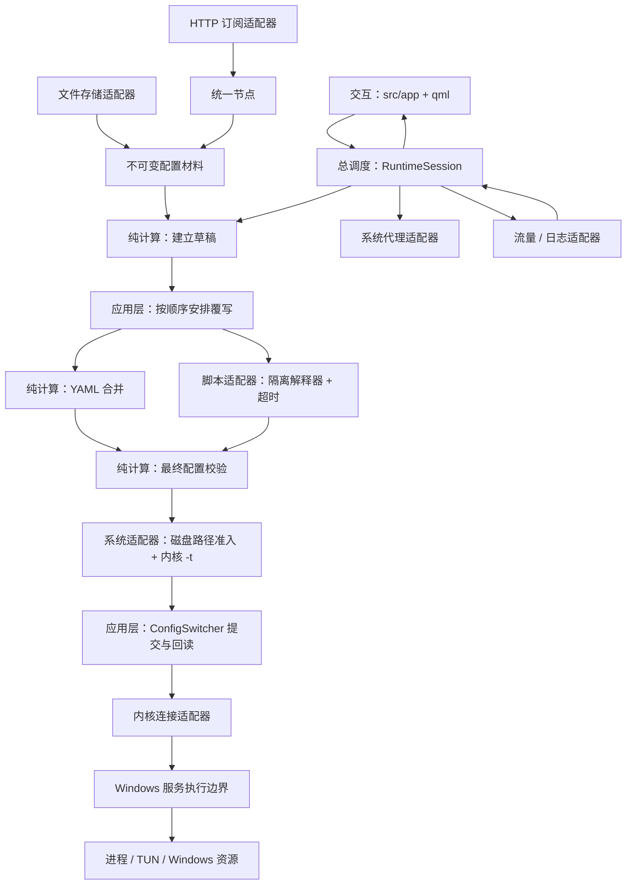

# BlankQuick：从输入到运行中的代理

## 项目现在做什么

这是一个 Windows 桌面代理客户端的后端和界面外壳。Mihomo 是独立运行的 Go 内核；本项目负责解释用户输入、准备配置、管理内核会话，以及安全地使用 Windows 资源。

目前 QML 只创建固定大小的空白窗口，`main.cpp` 配置窗口拖动、深浅色和 Mica 效果，尚未构造 `RuntimeSession`。因此启动界面不会自动拉取订阅、启动内核或修改系统代理。后端的能力已由库、服务与回归程序覆盖，下一步界面接入应当调用应用层，而不是直接调用系统适配器。

现有能力包括：

- 导入 Clash YAML、分享链接、Sing-box 和 WireGuard 等输入，转换为统一节点模型。
- 通过 HTTP 获取订阅并解析账户、配额、缓存验证等元数据。
- 保存订阅原文、节点缓存和版本身份，按快照组装节点、策略组、规则与提供者。
- 合并客户端设置、YAML 覆写与 JavaScript 覆写，生成并验证 Mihomo 配置。
- 启停内核，通过直接连接或受保护的 Windows 服务访问内核 API。
- 串行执行配置切换、回读、回滚和 TUN 操作，区分失败与无法确认的结果。
- 维护系统代理租约、异常退出恢复记录、实时流量、日志和网络环境观察。

## 三条线

数据层不会执行图中的网络、文件、脚本或进程操作。应用层决定何时跨越这些边界；适配器只接收明确的输入，返回数据、状态或错误。

## 按职责寻找代码

| 位置 | 负责什么 | 从哪里读起 |
| --- | --- | --- |
| `src/app`、`qml` | 窗口与用户交互 | `main.cpp`、`Main.qml` |
| `src/application/runtime` | 整个运行会话的调度和事务 | `runtime_session.hpp`、`configuration_preparation.cpp`、`config_switcher.cpp` |
| `src/application/profiles` | 从存储快照得到可复用的激活材料 | `profile_runtime.cpp` |
| `src/domain/nodes` | 统一节点模型、各种输入的纯解析 | `node_input.hpp`、`node_input.cpp` |
| `src/domain/subscriptions` | 订阅数据契约、响应头元数据和响应正文的纯解释 | `subscription_response.hpp`、`subscription_metadata.cpp` |
| `src/domain/profiles` | 配置数据、缓存编解码、节点筛选和最小配置组装 | `minimal_profile.hpp`、`profile_codec.hpp` |
| `src/domain/overrides` | 有界文档解析、YAML 合并、覆写报告 | `override_dom.hpp`、`override_engine.cpp` |
| `src/domain/runtime_config` | 设置编解码、Mihomo 导出和最终配置规则 | `runtime_config.hpp`、`configuration_document.hpp` |
| `src/domain/service_config` | 服务侧配置的纯整理和字符串路径约束 | `service_config_model.cpp` |
| `src/platform` | HTTP、文件、脚本、IPC、进程、TUN、系统代理和实时流 | 按应用层调用的适配器名称查找 |
| `src/services/kernel` | 提权后的执行、准入与资源回收 | `service_host.hpp`、`service_host.cpp` |
| `src/shared` | 无业务状态的公共数据工具 | 有界 JSON、顺序对象、IP 字面量、超时预算 |
| `generated/mihomo` | 从固定内核版本提取和生成的契约 | [生成流程](mihomo-sync.md) |

公开接口均在相应模块的 `include/blank/...` 下。目录表达职责，公开包含路径保持稳定；不要用相对路径跨模块包含私有实现。

`src/services/kernel/provenance.json` 保留最初导入时的路径和内容摘要，是来源快照，不是当前目录索引。重排目录不会改写这份快照的原始路径或摘要。

原先集中在 `runtime_config.hpp` 的副作用接口现已拆开：保存设置显式包含 `settings_storage.hpp`，执行内核校验包含 `kernel_check.hpp`，获取随机会话密钥包含 `runtime_context.hpp`。只读配置记录位于 `profile_types.hpp`，文件操作仍通过 `profile_storage.hpp`。这种拆分让包含关系直接说明调用者拥有哪种能力。

## 一次配置激活

1. 存储适配器读取一个确定版本的订阅快照；`profile_session` 从节点和原文组装材料。材料用只读共享快照传递，多个激活请求不需要复制整份节点池。
2. `makeActivationInput` 合并配置材料、设置快照和覆写选择，同时记录 profile / settings / binding / override 的版本身份。它不会读取磁盘，也不会发网络请求。
3. `RuntimeSession::submitActivation` 检查生命周期、当前事务、系统代理租约和 TUN 状态。接纳后分配请求身份，并按值向工作任务交付输入与取消令牌。
4. `composeActivation` 调用 `make_draft`，然后严格按输入顺序安排 YAML 合并或脚本执行。脚本只能返回 JSON 数据；输出仍要通过字节、深度、节点数量等限制。中间草稿允许暂时不满足最终业务规则。
5. `finalize_configuration` 在整条覆写链结束后验证模式、端口、引用关系、路径、DNS 和客户端保护字段，计算真实生效的设置。失败结果不携带可提交配置。
6. `prepareActivation` 调用服务配置准入和独立的内核 `-t` 检查。服务配置的纯整理位于数据层，磁盘重解析点检查位于平台层。fake-IP 持久化开启时，原生校验使用不写 fake-IP 持久化状态的临时副本，避免与运行内核争用同一个数据库。
7. `ConfigSwitcher` 先保存基线，提交候选，再依次回读配置、节点、规则、提供者和选择状态。成功的 HTTP 提交不是事务成功；全部所需回读完成后才确认应用结果。
8. `RuntimeSession` 发布事务结果并更新版本身份。若本次激活还要求 TUN，则继续安排服务端 TUN 操作；配置已经成功但 TUN 失败会明确报告部分应用。

仅包含 YAML 的调用者可以直接使用纯数据 API `runtime_config::generate`。包含脚本的完整用例必须进入应用层 `composeActivation`，因为脚本解释器和超时线程不属于数据计算库。

## 一个总调度者，两种进程职责

`RuntimeSession` 是客户端跨模块协作的唯一入口。`ConfigSwitcher` 是它内部的配置事务执行步骤，`prepareActivation` 是它安排的准备任务，二者不独立决定重启、系统代理或订阅行为。

`ServiceHost` 运行在另一个权限边界。它只接受受保护管道允许的命令，并维护自己拥有的内核进程和 TUN 资源。它没有订阅、配置存储、覆写管理或客户端应用层的依赖。服务自己的启停、观察和清理状态机不能替代客户端业务调度。

系统代理和流量读取器不会持有 `RuntimeSession` 或 `KernelController`：

- 系统代理适配器接收 `SystemProxyContext`，负责代理租约与恢复。
- 流量读取器接收 `TrafficContext`，负责读取和重连。需要订阅服务流时只发出意图信号，由 `RuntimeSession` 发送管道命令；命令结果带回流量代次，旧结果不能干扰新连接。
- 环境观察器只报告观察结果。DNS 刷新、服务资源修复等操作由各自权限边界的调度者安排。

## 必须保留的状态约束

- **无法确认不等于失败。** 配置提交超时或连接中断时，服务可能仍在执行。此时记录 `Uncertain`，不能并行提交回滚去与尚未完成的请求竞争。
- **旧异步结果不能推进新事务。** 客户端用会话代次和请求 ID 验证回调，服务还用 TUN 代次和资源身份校验工作结果。
- **停止有顺序。** 取消准备任务和事务后，先等待系统代理租约释放，再安排内核停止与资源清理；关闭信号只在屏障结束后发布。正常调用者应调用 `shutdown()` 并等待 `shutdownFinished()`。
- **先发布资产，再发布索引。** 存储适配器写入新的原文、缓存世代，最后原子替换索引。垃圾回收只能删除索引不再引用的内容，不能把清理失败误报成发布失败。
- **锁内不做未知外部工作。** 配置材料缓存只在查找和发布缓存槽位时持锁；组装在锁外完成。
- **观察不拥有资源。** 原生句柄、Qt 对象观察指针及跨回调的代次只用于观察；实际资源由 RAII、`unique_ptr`、只读共享快照或 Qt 父对象负责。

## 构建边界如何生效

`tools/architecture.json` 同时声明层级、模块依赖和每个构建目标允许直接链接的依赖。`cmake/Architecture.cmake` 在所有目标建立后读取它，在 CMake 配置阶段执行检查：

- 任何新建的非工具目标都必须登记。
- 依赖别名先解析成真实目标；每一条链接都要在白名单内。
- 即使一条边被误加到白名单，层级规则仍然阻止数据层链接平台、应用、界面或服务。
- 数据目标仅允许项目内的数据 / 公共工具 / 第三方解析库，以及用于字符串、URL、JSON 值操作的 `Qt6::Core`。它们不能链接 `Qt6::Network`、`Qt6::Qml`、进程/TUN/IPC 适配器或显式 Windows 系统库。
- Qt Core 本身也包含 I/O 类型，因此配置阶段还执行源码包含检查，拒绝数据层包含 `QFile`、`QProcess`、随机数、线程、Windows 等副作用接口；文件系统使用仅允许路径的词法计算。
- 数据目标还会优先搜索构建目录生成的 `data-boundary` 头文件屏障。包含 Windows、文件、进程等副作用头文件时立即触发编译错误；这个私有包含目录不传递给平台和应用目标。测试用宏间接包含头文件并真实调用 MSVC，确认不能绕过编译屏障。

默认 `quality` 目标和 CTest 继续验证 CMake 的实际依赖图、公共/私有包含关系、跨层来源、循环依赖及每个源文件是否恰好编译一次。这里约束的是项目显式依赖和源码边界；它不声称标准库或 Qt Core 在实现上完全不使用操作系统。

`tests/python/test_architecture.py` 用独立的小型 CMake 工程进行反向验证，覆盖越层链接、网络库、别名和未登记目标，避免护栏变成只会接受当前工程的摆设。

静态分析也区分接口用途：尚未接入界面的公开库入口及反射读取接口用标准 `[[maybe_unused]]` 标明，私有函数仍接受未使用检查。异常叶子类型保留标准异常的值语义，并在声明行说明 Clazy 复制检查的局部例外。Qt 信号可能同步销毁对象，两处 `QPointer` 存活检查有明确的 Cppcheck 建模说明，不能因为分析器把条件判为常量就删除这些重入保护。

## 验证入口

构建、测试、静态分析和独立构建目录的命令见 [README](../README.md)。三个 C++ 回归程序分别验证：

| 程序 | 关注的契约 |
| --- | --- |
| `profile_activation_test` | 导入、持久化缓存、重新加载、激活、嵌套字段导出和覆写隔离 |
| `domain_configuration_test` | 无 `QCoreApplication` 的确定性生成、IP/DNS 语法、纯设置编解码、服务配置整理及订阅响应解释 |
| `application_pipeline_test` | YAML/脚本顺序、脚本超时与隔离、最终保护字段、遥测代次、设置版本冲突、覆写绑定及会话接纳/关闭约束 |

这些回归不会替代真实内核、Windows 服务、TUN 驱动、休眠恢复和异常退出的虚拟机集成验证。修改相应平台实现时，应在隔离的 Windows 虚拟机中补做对应验证。

发布包增加 `-IncludeTests` 后包含上述三个回归程序和 `backend_vm_guest.ps1`。在虚拟机内运行 `powershell -NoProfile -ExecutionPolicy Bypass -File .\backend_vm_guest.ps1 -PackageRoot .` 可执行三套回归并保存结构化结果。系统状态前后快照由 `tools/backend_vm_snapshot.ps1` 单独采集。
