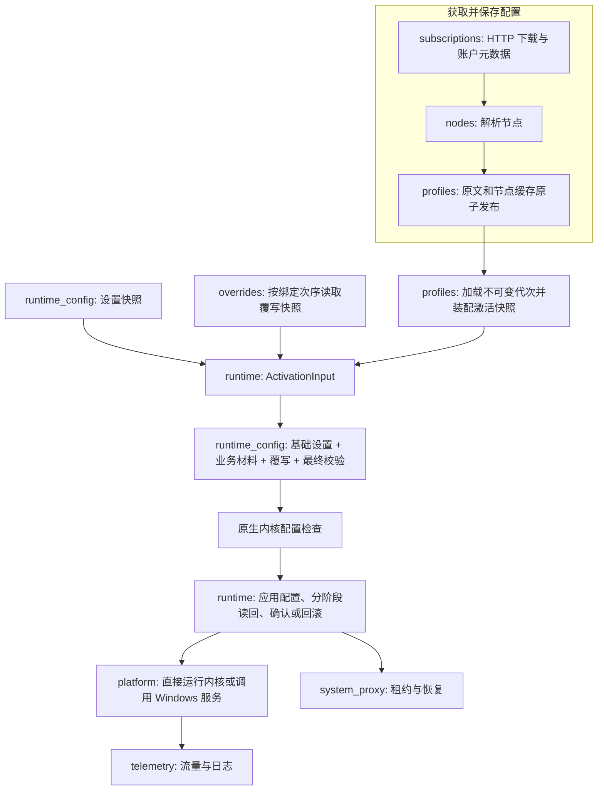
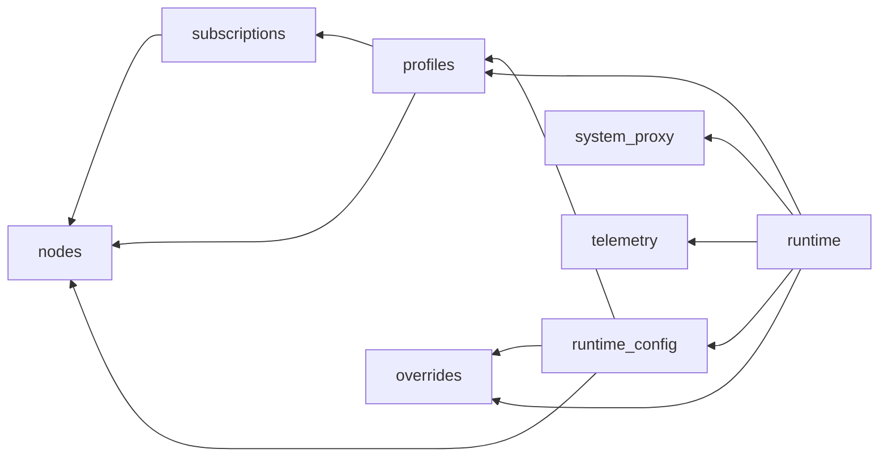

# 架构与业务关系

## 重构前的问题

`src/` 混合了订阅传输、节点解析、配置存储、配置生成和脚本覆写。`backend/foundation/` 同时容纳通用 Windows 适配器、Mihomo 控制器、流量流和用户代理功能。根 CMake 用递归文件收集和长排除列表划分库；头文件通过全局搜索目录互相引用，很难看出业务边界。

旧的三个生成器依赖没有入库的 `docs/unified_node_fields.json`、`docs/runtime_config_schema.json`，校验工具另外依赖相邻目录中的源码审计项目。统一节点模型已经记录 Mihomo 提交，但其字段映射和配置字段提取无法从当前仓库复现。

本次保留业务行为、现有存储格式、公开 C++ 类型名称和 Windows 状态机，把目录、编译目标、公开接口与业务能力对齐。原有实现仍有历史命名和 Windows API 封装；本次没有批量改写这些不相关逻辑。

## 业务切片

| 目录 | 拥有的行为与数据 | 主要入口 / 编译目标 |
| --- | --- | --- |
| `src/features/nodes` | 统一节点模型、URI/Base64/Clash/Sing-box/WireGuard 导入、有限资源的文档解析 | `node_input::parse_uri/parse_subscription`；`node_model`、`node_input` |
| `src/features/subscriptions` | HTTP 下载、代理路线、超时与取消、重定向、条件请求、账户与响应元数据 | `subscription_fetcher`；只读数据通过 `subscription_contracts` 导出 |
| `src/features/profiles` | 配置 CRUD、原文与节点缓存、摘要、不可变代次、节点筛选、组/规则装配、激活快照 | `profile_manager`、`profile_session`；`profile_storage`、`profile_payload`、`profile_runtime` |
| `src/features/overrides` | YAML 合并、JS 脚本执行与限时、覆写 CRUD、全局/配置绑定及执行次序 | `override_manager`、`apply_overrides`；`overrides` |
| `src/features/runtime_config` | 用户设置及持久化、节点导出、完整运行配置合成、最终校验、原生内核 `-t` 检查 | `settings_manager`、`generate`、`check_with_kernel`；`runtime_config` |
| `src/features/runtime` | 运行生命周期、激活事务、读回确认、取消/回滚、模式/节点/TUN 操作协调 | `RuntimeSession`、`ActivationInput`、`ConfigSwitcher`；`runtime_backend` |
| `src/features/system_proxy` | 系统代理租约、启停与恢复、Windows 用户代理适配器、异常退出守护进程 | `SystemProxyController`；`system_proxy`、`backend_user_proxy`、`system_proxy_guard` |
| `src/features/telemetry` | 流量订阅、内核日志 WebSocket、服务模式事件转发 | `TrafficController`；`telemetry`、`backend_streams` |

切片内部可以同时存在业务模型、存储和适配器。例如配置的摘要和缓存实现归 `profiles`，系统代理守护进程归 `system_proxy`。没有建立横跨所有业务的 repository/service/model 三层目录。

## 公开边界

每个切片只有 `include/blank/<feature>/` 暴露给其他切片，调用者使用完整的 `<blank/profiles/profile_runtime.hpp>` 一类路径。私有头文件、手写解析 `.inc` 和生成实现保留在切片内部；CMake 不向调用者公开这些目录。

节点切片提供 `node_input::material::extract_clash_material` 作为配置装配的有限文档接口；它替代了配置装配直接借用 `node_input::detail` 的旧关系。`overrides::dom` 是配置生成复用的显式文档接口，配置切片不访问 `override_detail.hpp`。

订阅账户、下载结果属于订阅切片的公开数据契约。配置存储可以接受这些结果，但不会调用 HTTP 下载器，且没有 `Qt6::Network` 链接依赖。存储与下载的协调仍应由调用用例完成。

## 基础适配器和程序入口

- `src/app/main.cpp` 与 `qml/Main.qml` 是 GUI 程序入口。当前没有注册业务展示模型，界面尚未接入下面的用例链。
- `src/platform/` 只容纳 Windows 句柄、持久化、进程、网络环境、服务 IPC/协议、TUN 资源和 Mihomo 控制器适配器。它不依赖业务切片。Mihomo 控制器在这里承担用户进程/服务模式的 I/O 转换，完整激活决策由 `runtime` 拥有。
- `src/services/kernel/` 是独立 Windows 服务的组合入口，复用进程、IPC、TUN 和日志流适配器，不引用 GUI 或运行会话。
- `src/shared/` 只有有限 JSON 读取和文档容器工具；节点模型和业务设置没有被塞进 shared。
- 每个切片自己列出 CMake 源文件和链接关系；根 CMake 负责组合，`cmake/FeatureQuality.cmake` 保留原有严格 MSVC 检查和具体兼容例外。

## 用例与状态流

保存后的配置由 `id/revision/generation` 标识。`load_session` 在工作线程完成一次一致材料读取，`activate` 使用只读内存快照，不下载也不读磁盘。保留原规则是存储的产品选择，也可以在本次激活中临时覆盖。

设置、配置、覆写各自保证自己的快照一致性，`makeActivationInput` 记录组合身份，不声称存在跨三个存储的数据库事务。运行会话生成候选配置后进行原生校验，再由 `ConfigSwitcher` 获取基线、提交、读回，失败后尽量回滚；无法确认时保留 uncertain 状态，不把请求已发出当成成功。

系统代理是独立事务。运行会话在停止过程中等待代理恢复和内核资源释放，保留原有 stop barrier。遥测消费状态与事件，不负责改变激活决策。

## 允许的切片依赖

`tools/architecture.json` 是允许关系清单。`tools/check_architecture.py` 同时检查实际 include 图、实际切片依赖和 CMake 求值后的链接图；拒绝环、跨切片私有引用、底层反向依赖、GUI 泄漏、配置存储链接 HTTP，以及业务源文件被错误目标编译或重复编译。CMake File API 和配置输入摘要用于拒绝过期的构建图。

## 验证范围

CTest 包含 Python 提取器边界回归、生成结果离线重现、构建依赖边界和真实 C++ 配置链测试。C++ 测试完成 Clash 导入、缓存保存/重载、规则装配、YAML 覆写、协议插件/嵌套传输字段/显式空列表导出、受保护字段拒绝和快照隔离。所有映射到 C++ 的字段路径在 `generated/mihomo/model_contract.cpp` 中编译检查。

这些测试不安装 Windows 服务、不修改系统代理、不创建 TUN 设备。实际服务权限、系统代理崩溃恢复和真实网络切换需要独立环境验证。`tools/backend_vm_guest.ps1` 是迁入时遗留的外部 `backend_lab.exe` 运行器，当前仓库没有该实验程序；`backend_vm_snapshot.ps1`/`probe_user_proxy.ps1` 仅用于环境观测，不属于默认测试链。
